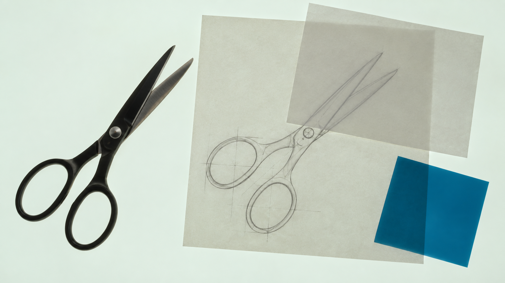
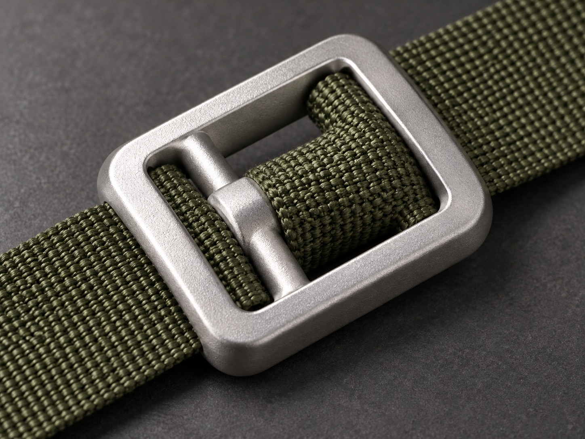
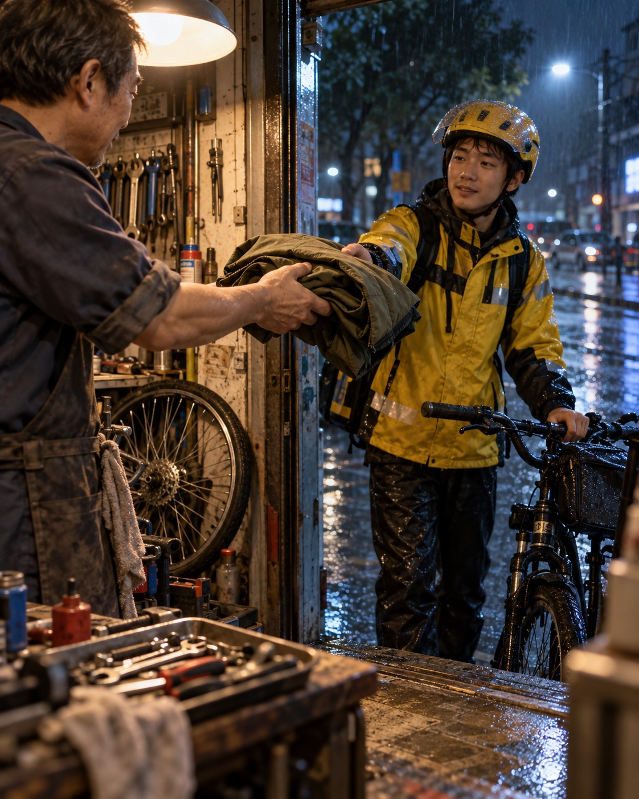
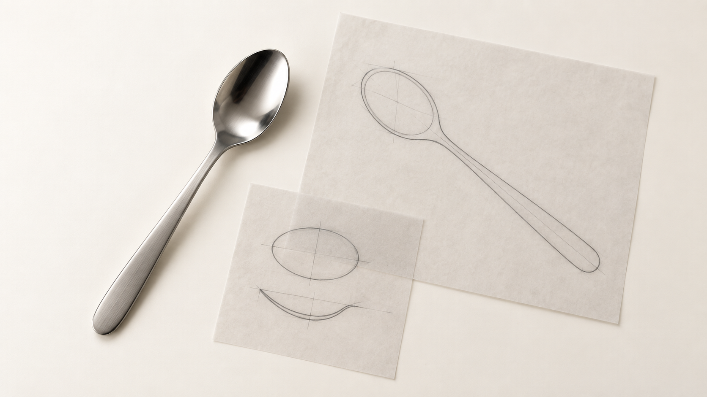
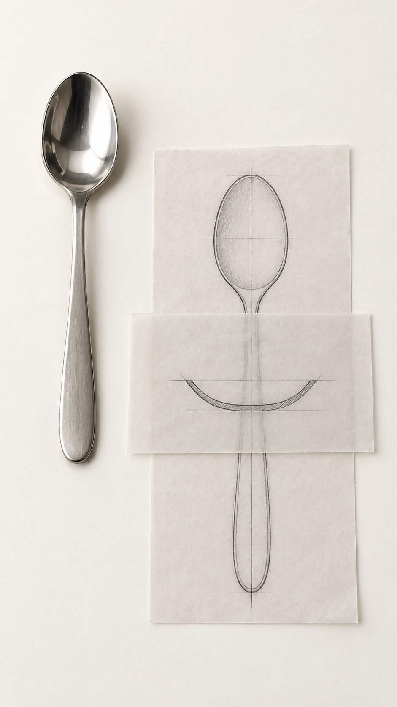

# Siuyu Lightbox Still Life

[简体中文](README.zh-CN.md) | [English](README.md)

**从材料、媒介与光，发展每一次创作的观看方式。**

Siuyu Lightbox Still Life 是面向 Codex 的图像创作 Skill。上传物件照片和风格参考，或从文字想法开始，设计构图、生成图片，再检查结构、光线和材料细节。仓库也提供适合 ChatGPT 网页普通 Chat 阅读的创作说明。

开放桌面创作先确定观看问题，再共同选择实物材料、研究媒介、构图和光色。研究稿可以采用透明片刻线、织样、木面刻痕、蜡的正负形、技术拆解或数字图面，具体选择服务本轮主体。简短光台请求采用**底光透射**：乳白台面从下方照亮薄层，实体保留暗部、反射和接触；选用纸层时检查交叠密度及下层线条。完整静物保留必要轮廓与余量。

也可以指定印刷编辑构图：实物与纸面图片组合、网点摄影，或直接印在织物上的图形。印刷工艺、分色、承载材质和底色分别选择，画幅沿用本轮要求。详见 [印刷方向](references/print-direction.md) 与 [可选本地印刷工具](modules/print/README.md)。

Codex 调用名：`$siuyu-lightbox-still-life` · 作者：siuyu · 版本：`1.3.0-rc.3`

[Codex 安装](#codex-安装) · [Codex 使用](#codex-使用) · [Codex CLI](#codex-cli-使用) · [ChatGPT 网页版](#chatgpt-网页版使用) · [完整图库](references/example-gallery.zh-CN.md)



*光从下方透过硫酸纸。两张纸交叠的区域更暗，被覆盖的铅笔线条也更淡，剪刀表面仍能看见金属反光。图片信息见 [配图说明](ASSET_SOURCES.md)。*

## 选择使用方式

| 使用的软件或环境 | 怎样开始 | 对应说明 |
|---|---|---|
| Codex 桌面端、IDE 扩展 | 安装 Skill，在 Codex 对话中调用 | [Codex 安装](#codex-安装)与[使用示例](#codex-使用) |
| Codex CLI | 安装 Skill，在终端启动 `codex` 后输入任务 | [Codex CLI 使用](#codex-cli-使用) |
| ChatGPT 网页普通 Chat | 把文档链接与参考图发进对话，按说明创作 | [ChatGPT 网页版使用](#chatgpt-网页版使用) |
| 本地脚本、配套渲染器 | 在终端执行对应程序，编译方向、检查记录或运行渲染器 | [命令行工具说明](CLI.zh-CN.md) |

## 可以创作什么

| 图像任务 | 当前可见示例 | 可以继续指定 |
|---|---|---|
| 光台与研究静物 | 九组横竖案例及底光硫酸纸 | 主体、图稿媒介、透射、材料和画幅 |
| 产品与材料摄影 | 金属扣件与织带 | 表面处理、光型、取景和接触 |
| 情境叙事摄影 | 雨夜门口递出外套 | 人物动作、观看位置、环境及光色 |
| 水彩插画与群像 | 社区温室 | 绘画媒介、投影、活动关系和密度 |
| 印刷与结构表达 | 自然语言方向和印刷工具 | 工艺、分色、载体及结构阅读，具体图像逐次评审 |

以下三张为本次实际生成的样张。点开图片查看原生文件，参数与评审见图片下方；新任务按其实际结果判断。

### 材料与产品摄影

[](assets/showcase/20261027/buckle-photo/image.png)

喷砂金属、织带纹理和孔边接触共同说明材料。

[Direction](assets/showcase/20261027/buckle-photo/direction.md) · [Arguments](assets/showcase/20261027/buckle-photo/tool-call.json) · [Review](assets/showcase/20261027/buckle-photo/review.md) · [Provenance](assets/showcase/20261027/buckle-photo/provenance.json)

### 情境叙事摄影

[](assets/showcase/20261027/rainy-doorway/image.png)

递接外套的动作、人物承托与室内外光共同形成故事。

[Direction](assets/showcase/20261027/rainy-doorway/direction.md) · [Arguments](assets/showcase/20261027/rainy-doorway/tool-call.json) · [Review](assets/showcase/20261027/rainy-doorway/review.md) · [Provenance](assets/showcase/20261027/rainy-doorway/provenance.json)

### 水彩插画与群像

[](assets/showcase/20261027/greenhouse-groups/image.png)

透视、透明叠色和多人工作关系共同组织场景。

[Direction](assets/showcase/20261027/greenhouse-groups/direction.md) · [Arguments](assets/showcase/20261027/greenhouse-groups/tool-call.json) · [Review](assets/showcase/20261027/greenhouse-groups/review.md) · [Provenance](assets/showcase/20261027/greenhouse-groups/provenance.json)


## Codex 安装

适用于已能访问本地文件的 Codex 桌面端、CLI 和 IDE 扩展。下面两种方式任选一种。首次使用 Codex CLI，可先阅读 [Codex CLI 官方安装说明](https://learn.chatgpt.com/docs/codex/cli)。

### 在 Codex 对话中安装

把下面这段话发送给 Codex：

```text
请从 https://github.com/masiuyu/siuyu-lightbox-still-life 安装这个 Skill。
先读取仓库说明并运行包校验，将完整 Skill 安装到 ~/.agents/skills/siuyu-lightbox-still-life。
如果已有同名版本，先完整备份。完成后检查 Codex 是否能发现它，告诉我实际安装位置和调用方式。
```

安装完成后新建 Codex 对话，使用 `$siuyu-lightbox-still-life`。尚未显示时重新启动 Codex。用户级与项目级目录见 [Codex 安装位置与更新](#codex-安装位置与更新)。

### 用终端安装到当前项目

已安装 Node.js 与 npm 时，在需要使用这个 Skill 的项目目录打开终端，运行：

```bash
npx skills add https://github.com/masiuyu/siuyu-lightbox-still-life --skill siuyu-lightbox-still-life --agent codex
```

这里使用第三方 [skills 安装工具](https://github.com/vercel-labs/skills)，`--agent codex` 指定目标软件，当前项目的安装入口为 `.agents/skills/`。完成后在同一项目中打开 Codex。

下载 ZIP 或使用 Python 脚本安装到用户目录，请看 [Codex 其他安装方式](#codex-其他安装方式)。

当前判断方法把内容的存在位置、成像方式和载体共同确定，再选择材料、光与机位。局部编辑使用明确主图与参考分工；灯光方向、柔硬、光量、灯色和白平衡分别说明。详见 [执行方式](references/prompt-execution.md)、[材料](references/material-color.md) 与 [光路](references/lighting-optics.md)。方法接入与实际成图效果按各任务记录分别验证。

[复合材料案例](references/material-construction-cases.md) 把基材、涂层、加工方向、角度色和薄壁透光接到具体设计与观察：木件、金属组件、薄膜书夹、灯罩、釉面、纤维和印墨分别选择形、光与取景。案例方向用于发展新任务，图片效果按实际生成结果判断。

默认按 [视觉层级与 Smooth Control](references/visual-hierarchy-smooth-control.md) 先确定主视觉目标，再组织构图、关键光色材质及必要细节。整体过渡、块面和空间保持清楚，真实摄影保留肤质、材料、接触及环境；微距、明确风格和局部编辑按各自任务处理。编译脚本逐字传递本张采用的方向。

[观看目的与成像选择](references/restaged-print-world-editorial.md) 把创作决定连接起来：要分辨表面，就给材料安排合适的受光面；要看懂结构，就选择能读到连接的视向与图形；要理解人物关系，就通过动作、距离和空间组织信息。配色、投影、密度和媒介随任务选择。随包方向可编译；扣件摄影、雨夜动作和温室群像已附当前样张及评审，装配说明继续按结构阅读目标验证；[方法来源与贡献](references/method-sources.md) 记录具体研究启发及使用范围。

## Codex 使用

以下文字发送到已经加载本 Skill 的 Codex 对话中。`$siuyu-lightbox-still-life` 用于调用 Skill；参考照片作为附件上传。

有明确的物件时，可以这样描述：

```text
使用 $siuyu-lightbox-still-life，根据附件生成一张 16:9 的光台研究静物图。
从台面正上方俯拍，保留主体的实际结构，在旁边安排对应的轮廓图和材料样片。
硫酸纸平铺在透光台面上，光从下面穿过纸张，交叠处的明暗差别清楚。
台面铺满画面四周，主体和图稿完整入镜，物件之间留出间距。
请实际生成图片，并打开结果检查。
```

还没有照片时，可以先描述想做的物件：

```text
使用 $siuyu-lightbox-still-life，自主设计一张 9:16 的玻璃杯材料研究图。
杯子的开口、杯壁、杯底和把手都要清楚可辨。
在杯子旁边安排轮廓图、玻璃样片和透光纸层，展示杯子的结构与玻璃的透光效果。
```

## Codex CLI 使用

在终端使用 Codex 时，先完成上面的 Skill 安装，再进入要保存本次作品的工作目录，运行：

```bash
codex
```

在打开的 Codex 交互界面中输入 `/skills` 检查已加载的 Skill，再发送上方 [Codex 使用示例](#codex-使用)。带图片启动、直接传入任务及脚本用法见 [命令行使用说明](CLI.zh-CN.md#codex-cli)。

## 按观看任务选择方向

| 画面方向 | 适合怎样的画面 |
|---|---|
| **底光透射（光台基线）** | 明亮乳白光台从下方照亮纸张和透明薄片，交叠处更暗，下层线稿更淡，实体物件保留表面反光与暗部。 |
| 柔光纸层 | 乳白台面上铺着描图纸，用柔和光线呈现纸张纹理，以及下层线条透过上层纸张的效果。 |
| 色场主视觉 | 用大面积的统一底色衬托物件，例如以蓝灰色台面突出白瓷杯的轮廓与明暗。 |
| 工作台动作 | 把描图、摆放或手持纸稿的动作放入画面，表现手、工具与物件的实际接触。 |
| 材质近摄 | 靠近物件，观察金属反光、拉丝纹理或纸张纤维，围绕指定细节安排取景。 |

表中是可用的起点。开放探索按 [视觉语言](references/visual-language.md) 选择图像形成方式，以 [研究媒介](references/study-artifacts.md) 组织图稿，再用 [材料形成](references/material-process-atlas.md) 与光共同实现。系列可选择一致关系；多方向探索则比较实际的媒介、形体、空间和明暗差异，横竖分别构图。

## 横幅与竖幅，分别构图

| 16:9 横幅 | 9:16 竖幅 |
|---|---|
|  |  |

横幅和竖幅各自安排主体、图稿与纸层的位置。制作一组图片时，可以保持物件、材料和色调一致，再根据画幅调整分组和间距。

## 随包提供的案例

以下为既有光台图片证据，各自说明对应任务。新增媒介方法的实际效果依据后续获授权的成图与评审积累。

原有光台图库收录九组主题，每组各有一张横幅和一张竖幅，共十八张图片；加上底光硫酸纸和三张跨题材新样张，当前包共有二十二张独立成图。你可以在 [完整图库](references/example-gallery.zh-CN.md) 中并排查看构图，并打开每张图的生成记录和看图记录。

| 案例 | 观察重点 |
|---|---|
| [玻璃杯透光研究](references/example-gallery.zh-CN.md#example-01) | 杯口、杯底和把手怎样连接，玻璃样片叠放后怎样透光。 |
| [咖啡勺轮廓与纸层](references/example-gallery.zh-CN.md#example-02) | 勺子的轮廓怎样对应纸上的石墨图稿。 |
| [瓷杯色场主视觉](references/example-gallery.zh-CN.md#example-03) | 蓝灰色台面怎样衬托白瓷杯与杯碟。 |
| [咖啡勺描绘操作](references/example-gallery.zh-CN.md#example-04) | 一只手压住纸张，另一只手握笔描绘时的接触位置。 |
| [咖啡勺表面近摄](references/example-gallery.zh-CN.md#example-05) | 勺碗的抛光反射与长柄的拉丝纹理。 |
| [咖啡勺工艺比较](references/example-gallery.zh-CN.md#example-06) | 抛光钢片、拉丝钢片和纸上铅笔排线之间的比较。 |
| [手持咖啡勺图稿](references/example-gallery.zh-CN.md#example-07) | 双手托起纸稿时的纸张弯曲，以及下层线条在覆盖区域内外的深浅。 |
| [棉纸字形压纹](references/example-gallery.zh-CN.md#example-08) | 字母压纹的深浅、纸张纤维与切边。 |
| [柔光箱透光纸层](references/example-gallery.zh-CN.md#example-09) | 单层纸与叠层纸的明暗差别，以及跨过纸边界的铅笔线条。 |

## 自然语言工作方式

直接说明主体、图幅、要保留的内容和希望看见的效果。AI 查看来源后，用自然语言保存 direction.md，讲清每张参考的用途、物件之间的关系、制作与光照，再执行并看图。

常规方向文件采用“参考图片”和“成像说明”两段，观察和取舍放在工作记录。`lightbox.py compile` 原样传递正文与图片顺序，`check` 核对指纹，`review` 汇总实际观察。编译、成像、视觉评审和用户接受分别有证据。详见 [执行方式](references/prompt-execution.md) 与 [迁移说明](references/interface-migration.md)。

## 它怎样工作

1. **确认主体与参考用途。** 查看你提供的附件，确认物件的部件和外形，以及各张参考用于说明什么。只有文字要求时，先确定要呈现的物件及其结构。
2. **设计并生成画面。** 安排光线、材料和物件的位置，整理完整提示词，再调用当前环境的图像生成工具。Codex 完整流程会保存方向记录，并通过脚本编译图像任务。
3. **打开图片检查。** 核对主体结构、纸层透光和构图，再检查物件与台面的接触，以及操作场景中手与工具的位置。有具体问题时，再据此调整画面。

在 Codex 中，常规交付包含生成图片、画面方向、实际成像任务和简短的看图记录。网页版按当前对话的能力提供成图、提示词和必要说明，见 [ChatGPT 网页 Chat 创作说明](CHATGPT.zh-CN.md)。

## Codex 常用请求

以下示例发送到 Codex 对话。ChatGPT 网页 Chat 的复制指令见[对应入口](#chatgpt-网页版使用)。

**保留产品的外形和材料特点：**

```text
使用 $siuyu-lightbox-still-life，把附件中的产品做成光台材料研究图。
保留产品的实际结构和颜色，纸上图稿与产品轮廓对应，
材料样片选用与产品表面相符的材质。
```

**制作一组横幅和竖幅：**

```text
使用 $siuyu-lightbox-still-life，为同一主体分别设计一张 16:9 和一张 9:16 的图片。
两张图保持材料和色调一致，根据各自的画幅安排物件、纸层和周围的留白。
```

**调整已有图片的透光效果：**

```text
使用 $siuyu-lightbox-still-life，继续修改这一版。
保持主体与图稿的位置，增强光线从下方穿过硫酸纸的效果。
两张纸交叠的位置要比单层更暗，被盖住的铅笔线条要更淡。
请查看修改后的图片，核对这两处变化。
```

## ChatGPT 网页版使用

打开 [ChatGPT](https://chatgpt.com/)，新建普通 **Chat** 对话，上传参考图片，再把下面这段话发送给模型。网页方式通过读取创作说明在当前对话中使用；准备好链接和附件即可开始。

```text
请读取 Siuyu Lightbox Still Life 的 ChatGPT 网页创作说明：
https://github.com/masiuyu/siuyu-lightbox-still-life/blob/main/CHATGPT.zh-CN.md

按照文档要求，根据附件生成一张 16:9 的光台静物图。
保留主体结构，搭配对应设计稿和完整的矩形描图纸。
底光透过单层与叠层纸张，主体、工具和全部纸边完整入镜，物件之间留出自然间距。
请实际生成图片，并按我的反馈继续调整。
```

把主体、画幅和画面要求换成自己的需求。完整操作与更多示例见 [ChatGPT 网页 Chat 创作说明](CHATGPT.zh-CN.md)。

### 链接读取与图片生成

- **链接读取失败：** 打开 [CHATGPT.zh-CN.md](CHATGPT.zh-CN.md)，把全文粘贴到对话，或下载后作为附件上传，再发送创作要求。
- **当前对话只能处理文字：** 可以先索取完整提示词，再交给自己选用的图像工具；需要在 ChatGPT 内完成成图时，使用支持图像生成的对话。功能可用性取决于套餐与工作区设置，见 [ChatGPT 图像功能说明](https://learn.chatgpt.com/docs/image-generation)。
- **用量：** 普通 Chat 按当前账号的消息与图像用量规则使用。ChatGPT Work 与 Codex 共享使用额度，具体规则见 [OpenAI 用量说明](https://learn.chatgpt.com/docs/pricing)。

## 运行环境

Skill 提供创作流程与配套脚本。各软件负责提供文件访问、图片查看及图像生成能力。

| 使用方式 | 所需条件 |
|---|---|
| Codex 桌面端、CLI、IDE 扩展的完整流程 | Codex 能加载 Skill、读写文件并查看图片；Python 3.10 或更新版本；实际成图需要可调用的图像生成工具 |
| 通过 `npx skills` 安装 | 终端、Node.js 与 npm；安装命令指定 Codex |
| 运行仓库 Python 脚本 | 本地 Python 3.10 或更新版本；方向与评审命令使用标准库，图片证据命令另需 Pillow；各命令的输入与输出见 [Python 脚本说明](CLI.zh-CN.md#python-scripts) |
| ChatGPT 网页普通 Chat | 能读取链接、粘贴文本或上传文档；实际成图需要当前对话支持图像生成 |
| 配套本地渲染器 | 单独准备并验证渲染器工程、Node.js、pnpm 及工程依赖，见 [渲染器 CLI](CLI.zh-CN.md#renderer-cli) |

本项目的完整图像流程已在 Codex 桌面环境验证；其他客户端按实际工具配置使用。需要适配其他 Agent 时，按其 Skills 目录、附件接口、脚本执行和图像工具要求配置。

## Codex 其他安装方式

以下命令在 macOS、Linux 或 Windows WSL 终端执行。目标是将本 Skill 安装到 Codex 可发现的用户目录，供本机各项目使用。

### 从 GitHub 克隆后安装

需要 Git 与 Python 3.10 或更新版本：

```bash
git clone https://github.com/masiuyu/siuyu-lightbox-still-life.git
cd siuyu-lightbox-still-life
python3 scripts/validate_skill.py .
python3 scripts/install_skill.py --target-root "$HOME/.agents/skills"
```

### 从 ZIP 安装

下载仓库 ZIP，解压后在包含 `SKILL.md` 的目录打开终端，再运行：

```bash
python3 scripts/validate_skill.py .
python3 scripts/install_skill.py --target-root "$HOME/.agents/skills"
```

### Codex 安装位置与更新

上面的用户级安装位置为 `~/.agents/skills/siuyu-lightbox-still-life`。项目级安装放在该项目的 `.agents/skills/siuyu-lightbox-still-life`。目录规则见 [Codex Skills 官方说明](https://learn.chatgpt.com/docs/build-skills)。

更新通过本仓库 Python 脚本安装的版本时，先取得最新仓库文件，再在仓库目录运行：

```bash
python3 scripts/validate_skill.py .
python3 scripts/install_skill.py --target-root "$HOME/.agents/skills" --backup-existing
```

旧版完整保存在目标 Skills 目录旁的 `skill-backups/` 中，脚本会输出实际位置。使用自定义目录时，将 `--target-root` 换成当前安装位置的父目录。通过第三方 `skills` 工具安装的版本，按该工具的更新方式管理。

脚本自身未指定 `--target-root` 时，使用 `$CODEX_HOME/skills`，或环境变量未设置时的 `~/.codex/skills`。上述命令通过显式指定目录，与当前 Codex 本地 Skills 目录说明保持一致。安装后新建对话；Skill 尚未显示时重新启动 Codex。

## 按用途查阅文档

| 文档 | 适合谁阅读 |
|---|---|
| [Codex 安装与调用](#codex-安装) | 在 Codex 桌面端、CLI 或 IDE 扩展中使用本 Skill 的用户 |
| [命令行使用说明](CLI.zh-CN.md) | 使用 Codex CLI、安装工具、Python 脚本或配套渲染器的用户 |
| [ChatGPT 网页 Chat 创作说明](CHATGPT.zh-CN.md) | 通过文档链接、粘贴或上传方式创作的网页用户 |
| [Agent 执行说明](SKILL.md) | 执行本 Skill 的 Codex，或正在适配完整流程的 Agent |
| [Python 方向编译与成像调用](references/prompt-execution.md) | 需要整理方向文件、编译图像任务和保存生成记录的操作者 |
| [配套渲染器工作流](references/offline-workflow.md) | 已有本地渲染器工程、需要确定性导出或源图层合成的开发者 |
| [本地渲染器工程开发](references/codex-execution.md) | 需要开发、安装或集成配套渲染器的开发者 |
| [示例图库](references/example-gallery.zh-CN.md) | 查看成图、构图与材料表现的所有读者 |

## 包内结构

```text
siuyu-lightbox-still-life/
├── SKILL.md                 # Codex 与适配 Agent 的中文执行说明
├── README.md                # 英文项目介绍与安装说明
├── README.zh-CN.md          # 中文项目介绍与安装说明
├── CLI.md                   # 英文命令行说明
├── CLI.zh-CN.md             # 中文命令行说明
├── CHATGPT.md               # ChatGPT 网页英文创作说明
├── CHATGPT.zh-CN.md          # ChatGPT 网页中文创作说明
├── ASSET_SOURCES.md         # 配图信息
├── agents/openai.yaml       # 名称、图标与默认调用
├── assets/                  # 配置样例、摄影预设与生成图片
├── references/              # 中英文图库与详细创作指南
├── scripts/                 # 安装、编译和检查脚本
└── evals/                   # 行为评估场景
```

## 常见问题

**一定要上传照片吗？** 如果想保留某件物品的外形，请上传它的照片；如果是探索新的设计，可以从文字开始。附上多张参考时，请说明哪张用于确认物件结构，哪张用于参考光线、颜色或构图。

**能指定比例和像素尺寸吗？** 默认横幅为 16:9，竖幅为 9:16，也接受其他比例或目标像素尺寸。实际尺寸取决于图像工具的输出，交付记录会注明。随包案例的原生尺寸为 1672×941 或 941×1672，与目标比例有像素取整造成的细小差异。

**每次都会采用同样的摆法吗？** 摄影预设提供光线和材料的处理方式，具体物件、图稿和布局根据本次要求设计。修改已有图片时，可以说明哪些位置、颜色或材料需要保持。

**案例图片可以下载吗？** 可以。二十二张独立成图随仓库保存在 `assets/` 中，克隆或下载 ZIP 后即可在本地查看，生成来源见 [素材来源](ASSET_SOURCES.md)。

## 配图与发布信息

随包的二十二张独立成图均由 AI 图像工具生成。九组横竖案例、底光硫酸纸和三张新样张呈现器物结构、材料、人物关系与绘画表现；网页预览是对应图片的格式导出。各图的生成方式与图片信息见 [配图说明](ASSET_SOURCES.md)。当前版本为 `1.3.0-rc.3`。

## 形式发展与材料比较

开放创作先明确观者要发现什么，再选择展开、穿孔、折弯、叠层或分色。系列固定主体与研究的对应，横竖重新构图；整体身份与微观墨层可以分给不同图片。见 [形式发展](references/design-development.md)、[六组案例学习](references/case-derived-lessons.md) 与 [开口研究样例](assets/opening-study.example.md)。本轮案例方法已接入说明与方向准备，新图效果仍需对应测试。

[墨层结构小样](assets/ink-layer-study.example.md) 用连续底墨块和独立结构墨检验层序，再迁移回目标图形；该小样当前为待执行方向。

## 跨题材的材料、灯光与风格方法

[材料指导](references/material-color.md) 分别处理颜色覆盖、反射、纹理尺度和实际形状，用金属、陶器、玻璃、木材、织物与纸张示范判断。[灯光指导](references/lighting-optics.md) 为光分配可见任务，并检查同场相互影响。[风格迁移](references/style-transfer.md) 保留当前主体身份，将选定视觉关系落实到新材料与画幅。[釉陶](assets/ceramic-surface-study.example.md) 和 [玻璃](assets/glass-volume-study.example.md) 两份示例方向已经准备，实际图片效果待测试。

## 创作关系与按需调用

[创意判断](references/creative-judgment.md) 将已有专业知识用于当前选择：提出能组织全图的主张，比较代价与实现条件，提前记录关键预期，再依据实际图片决定下一动作。已有方案可以继续深化，用户认可的内容按实际范围保留。

[创作调用](references/creative-orchestration.md) 把任务、主体特征、视觉主张、形式、材料、光与机位连接起来，并说明出现问题后返回哪个环节。复杂任务按需展开，明确的局部修改直接进入对应模块。[美术指导](references/image-art-direction.md) 补充概念、大形、色场、留白与继续观看的关系；[提示词模式](references/prompt-patterns.md) 将选定决定写成可执行画面；[机位与运动](references/camera-and-motion.md) 区分静态时刻、视角、物件和灯光变化。

[玻璃主视觉](assets/open-form-hero.example.md) 与 [双色艺术图面](assets/open-form-artprint.example.md) 示范不同媒介中的形式与材料选择，当前为已准备的方向。实际图片与视频效果分别由对应产物验证。

## 从光场到交付图片

[成像处理](references/image-development.md) 把场景与曝光、色调、最终观看连接起来，补充发光物和关键阅读区的判断。[材料指导](references/material-color.md) 说明纹理怎样沿局部表面延续；[机位与运动](references/camera-and-motion.md) 区分稳定实体关系与各视角的投影。[创作调用](references/creative-orchestration.md) 按材质、灯光、机位、裁区、媒介或调色的实际改变，选择需要重查的决定。方法已经接入，视觉改善按实际输出验证。

## 已有图片、调用与评审的对应

可选的 [图片证据](references/image-evidence.md) 工作流连接编译包、保存的 imagegen 参数、原生图及评审，并能逐像素核对索引中的原生裁区、复查留存后的文件变化。该功能需要 Pillow；常规方向编译和评审沿现有接口执行。视觉质量与用户接受继续使用各自证据。

## 尺寸与观看的共同判断

[取景](references/camera-framing.md) 合并旋转物件的完整布局，分开判断实体大小、画面占比和细节像素；扩大视场后复查材料线索与光。[模型建构](references/model-construction.md) 把人物或动物的识别特征落实到所选成品工艺，[材料判断](references/material-color.md) 让颜色、反光和起伏由相容成因解释，并检查比较样片。[机位与运动](references/camera-and-motion.md) 检查途中覆盖、新显表面和最终播放。本地方法已接入，新增图像与视频效果按实际产物验证。

需要重复计算时，可选用 [取景预检](references/framing-preflight.md) 的 `lightbox.py framing`：按明确依据或设计假设，检查旋转矩形、边缘余量与细节像素。它只计算计划，方向和图像执行继续采用自然语言接口。
