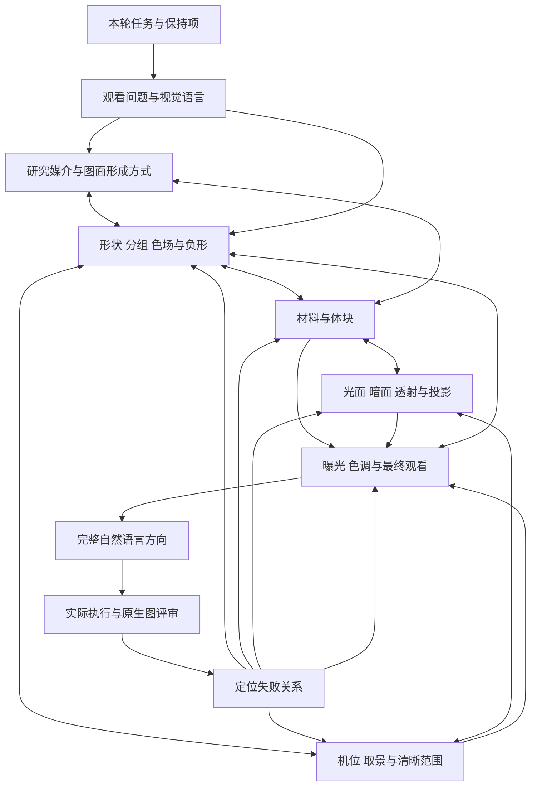

# 从任务到画面的创作调用

本指南把美术、形式、材料、光和摄影连接起来。复杂创作、换媒介、系列或多镜头规划时按相关关系展开；简单请求和已经确定的局部修改直接进入对应部分。这里是执行者的判断路径，编译器负责传递已经选定的自然语言说明。

## 先确定这次在完成什么

先读请求及当前实际材料，确定这次要完成的产物：方向分析、完整成图、局部编辑、材料近景、系列适配，或明确的视频镜头规划。主体身份、用户保持项、画幅、实际可用素材和执行范围是后续决定的共同依据。

普通光台请求沿主入口的底光、完整俯拍和主体研究关系执行。开放桌面、单件主视觉、艺术图面、印刷或动作先选择相应表现方式；变换材料、器形和内容时先判断本轮是否属于新概念。[视觉语言](visual-language.md) 用于将参考中的形、边缘、密度、空间和光色转成决定，先确定观看问题再调用专门方法。

本 Skill 的系列延续与展示先用 [连续柔光与材料陈列](lightstage-language.md) 明确共同视觉关系，再选择新的观看问题。侧视材料陈列可以用扩散背景和实体补光，平面研究可以用发光台与透射薄层；所选机位、受力与光场一起写入方向。

开放方向与方案深化先用 [创意判断](creative-judgment.md) 形成能组织全图的决定，比较当前用途下的代价与实现条件，再按需要调用材料、媒介及摄影知识。所选关系决定各模块要解决什么；专业建议与用户保持项相互核对。

先把本轮关键现象写成一条短链：它存在于哪里，怎样形成或被记录，由什么载体呈现，观者要读出什么。实体、内部影像、屏幕内容和光学界面各按相应路径判断，再联合选择形状、材料、光与机位。具体写法见 [内容怎样成为影像](study-artifacts.md#说明内容怎样成为影像)。

局部编辑用当前主图约束场景，其他资料只贡献指定属性。变更属性和必要的接触、阴影、反射连带关系先确定，实际调用沿 [执行方式](prompt-execution.md#局部编辑采用明确的主图与变化范围) 控制。默认做法只补足当前尚未指定的内容。

## 让上一个决定给下一个决定提供依据

| 当前要解决什么 | 选读实际模块 | 形成什么决定，供后续使用 |
|---|---|---|
| 观者应当辨认、理解或感到什么 | [观看目的与成像选择](restaged-print-world-editorial.md)、[视觉语言](visual-language.md) | 需要可见的关系，以及机位、媒介、材料与光怎样共同实现它 |
| 主体和每张参考分别提供什么 | [来源关系](object-relations.md)、[主体研究](subject-structure.md) | 本张对象、连接、图面和保持项；参考的具体用途 |
| 哪项主张值得采用，哪些要求需要取舍 | [创意判断](creative-judgment.md) | 关键可见关系、选择理由、主要风险与执行前的预期观察 |
| 研究物通过什么媒介解释主体 | [研究媒介](study-artifacts.md) | 本张研究问题、选择的图稿或材料形成方式、信息范围与承托 |
| 希望观者发现什么，概念怎样属于当前主体 | [美术指导](image-art-direction.md)、[形式发展](design-development.md) | 视觉主张、基本单元与选定操作，主次、分组和负形 |
| 哪种构造、状态、表面和体积实现主张 | [模型建构](model-construction.md)、[材料形成](material-process-atlas.md)、[材料与配色](material-color.md)；复合表面选读 [构造案例](material-construction-cases.md) | 当前对象的构造与状态、各层及连接、体块、覆盖、反射、起伏、透射与颜色分工，并交给光及机位选择可辨条件 |
| 从哪个位置、用什么光看到这些关系 | [摄影](photography.md)、[光路](lighting-optics.md)、[取景](camera-framing.md) | 识别面、机位、光面和暗面、投影、焦点及细节面积 |
| 产品镜头中的材料、道具与位置怎样配合 | [镜头协同](photography.md#产品镜头把材料位置与光一起确定)、[透明材料光场](lighting-optics.md#透明材料的视角光场与层次) | 本张材料窗口、相机前的深度与遮挡、反射或透射阅读区、道具作用和实际清晰区域 |
| 亮暗、色彩和细节怎样进入最终图片 | [视觉层级与 Smooth Control](visual-hierarchy-smooth-control.md)、[成像处理](image-development.md) | 主视觉目标、大尺度过渡、信息密度、必要材质、关键阅读区及允许的明暗色彩变化；真实摄影按其控制链共同检查 |
| 墨层和载体怎样共同形成图像 | [印刷判断](print-direction.md) | 指定图面、载体、分色、覆盖层序和实际观察位置 |
| 新题材或新媒介怎样延续所选关系 | [风格迁移](style-transfer.md) | 保持的视觉关系、当前身份和本张具体实现 |
| 镜头中什么改变，什么保持 | [机位与运动](camera-and-motion.md) | 起始状态、主要变化、结束画面与相邻镜头承接 |
| 怎样把这些决定交给工具 | [提示词模式](prompt-patterns.md)、[执行方式](prompt-execution.md) | 已选方案的完整提示词、参考顺序和预定观察位置 |

实际只读本轮需要的模块。材料已确认而只改光时，读取光路与相关摄影要求；墨层不清楚时，优先检查层序及其观察条件。已有明确方案时，局部细化即可。

出现尺度冲突时，先用 [取景](camera-framing.md) 同时核对实体尺寸、旋转后的布局范围和关键细节像素，再回到构图、材料与光选择取舍。人物模型先用 [模型建构](model-construction.md) 选择识别特征的制作方式；局部表面变化后，用 [材料判断](material-color.md) 检查相邻部位及对应样片。明确的视频请求再沿 [机位与运动](camera-and-motion.md) 判断途中覆盖、隐藏表面和最终播放。

## 材料、光、相机和构图共同求解

例如，构图需要一片宽阔平静的玻璃面，材料要求透明，相机要看到内部，光却在同处映出大白亮斑。这时重新安排可见光面、主体摆向或阅读区；釉面、亮膜和金属也按自己的反射行为判断。若修正破坏了已经锁定的构图，就在允许范围选择另一条光路。

又如，强烈侧光可以让压纹和长投影同时出现。压纹承担细节，投影成为大形的一部分，主体与投影之间的间隙参与构图；随后检查这种显纹程度是否仍符合纸张的细腻尺度。整体主张与局部真实性需要同时成立。

## 把不同类型的变化放回正确位置

物体变形、相机移动、灯光移动、调色和印刷分色，各有不同作用。先明确实际改变的是哪一项，再判断它是否影响身份、投影、反射或内容可见性。

改变机位可能显出新的侧面；全图裁切改变内容面积；二维推近只重新分配已有像素。它们的结果和证据不能互相代替。改变整体色调可能同时影响主体识别色、墨色和半透明层密度，应用前先确定允许范围。

制作系列时，固定的是本轮选择的视觉关系，各材料用相容方式实现；制作镜头序列时，接续还包括物件状态、朝向、主要光向和动作结果。实际摄影、渲染、文生图和视频工具的控制能力各自核对。

## 改动后只重开受影响的决定

先读当前实际结果与最新反馈，指出本轮改变和保持的关系，再沿依赖选择复核。下面是起点，实际范围由本次变化决定；一处局部修正无需重新选择整个创意。

| 本轮改变 | 优先复核哪些后续关系 | 可以沿用的依据 |
|---|---|---|
| 外形、开口或连接 | 图稿对应、遮挡、支撑、光影与必要视面 | 与这些部位无关且仍相容的材料、色场及内容 |
| 材料、涂层或纹向 | 显示材料所需的光、颜色、局部方向与细节面积，比较样片的对应 | 已确认且未改变的主体身份和几何 |
| 光面、暗面或色光 | 反射、投影、透射、关键阅读区与曝光，整体视觉重量 | 光照变化后仍可辨的形状与布局 |
| 相机位置、物体摆向 | 新显出的面、反射、遮挡、焦点和完整性；序列另查空间接续 | 有依据的实体结构与场景关系 |
| 裁区、画幅或输出大小 | 主次、组距、旋转后的必要轮廓、真实细节面积及各物件受光 | 仍在画面中的身份及材料要求 |
| 曝光、调色或细节处理 | 产品识别色、纸墨层次、纹理尺度和亮暗阅读区 | 实际未改动的几何、位置与图面内容 |
| 载体、工艺或表现媒介 | 图面附着、材料实现、边缘语言和当前验收目标 | 明确选择继续采用的主体关系与视觉主张 |

例如，小猫腹部细缎面收细后，先看曲率、反射柔化和原生纹理，再查轮廓、吊环与既有纸层是否保持；不必重新推导整张构图。织物第二墨仍难读时，优先回到端点、连续底墨、层序和观察光；全图调色无法单独证明墨层关系。

同一现象可能有多个原因。选择本轮可操作且有证据的一项，写清预期可见变化；成图后检查它及相邻保持项。若结果仍无法区分原因，下一任务可选择更清楚的观察条件，图片次数继续按授权处理。新增观察与已有通过项分别记录。

## 在方向里保留足够的决定

工作记录可简短写明：这张让观者发现什么；用哪个主体特征形成主次；材料、光与机位怎样共同支持；关键保持项和观察位置。已有决定明确时无需重复分析。

成像说明直接写最终画面。先让工具明确对象、载体、空间和主要动作，再写对本张有作用的表面、光和清晰范围；参考用途及重要保持项在需要处说明。段落次序按任务选择，内容必须彼此相容。脚本的两段自然语言接口继续使用。

## 按失败层级返回相应模块

| 实际问题 | 下一步优先回到哪里 |
|---|---|
| 主体身份、数量或图面归属错误 | 当前请求与来源关系；结构重建使用正确身份资料 |
| 图片清楚但主张与视觉重点没有成立 | 美术指导与形式发展；重新安排大形、尺度和对应 |
| 开放探索的不同方向只有相似的陈列和表面变化 | 视觉语言与研究媒介；重新选择观看问题、图稿形成方式和空间关系，再求解材料与光 |
| 光泽、纹理或覆盖看起来不相容 | 材料判断与光路；区分表面变化和观察条件 |
| 明暗、颜色或发光淹没必要信息 | 成像处理与具体受光区域；分别检查光面位置、曝光、色调及实际输出 |
| 需要的细节太小或失焦 | 摄影与取景；调整面积、机位或独立近景任务 |
| 墨层深浅被画成凹槽 | 印刷层序及材料小样，检查连续底墨和上层收边 |
| 系列正确题材之间缺少联系 | 风格迁移；对照预先选择的关系逐项定位 |
| 运镜使物体变形或画面越界 | 机位与运动；核对实际变化、必要轮廓、途中最大偏移及起止状态 |

核心身份和几何问题优先处理，随后判断观看主张、材料、光和细节。每次针对当前主要问题改动，重查其依赖关系及保持项；实际图片次数服从授权。技术通过、可见效果、用户接受和发布分别记录。

选定实际原生图和评审版本后，可按 [图片证据](image-evidence.md) 将其与保存的调用连回编译方向。返回修正模块前，先区分可见矛盾和观察条件不足，具体判断见 [从观察选择下一次修正](physical-realism.md#从观察选择下一次修正)。

[玻璃主视觉方向](../assets/open-form-hero.example.md) 与 [艺术印色方向](../assets/open-form-artprint.example.md) 示范同一个基本单元怎样分别落实到实体光影和图面色场。它们是新概念方向，实际图像效果按各自执行记录判断。

社区 [3D 调用编排](https://github.com/MAX-786/claude-3d-harness/blob/main/SKILL.md) 启发按任务读取实际需要的能力，并在编辑时缩小范围。本指南使用当前本地模块与实际执行接口，外部工程的工具、执行预算和安装方式各属其原流程。
